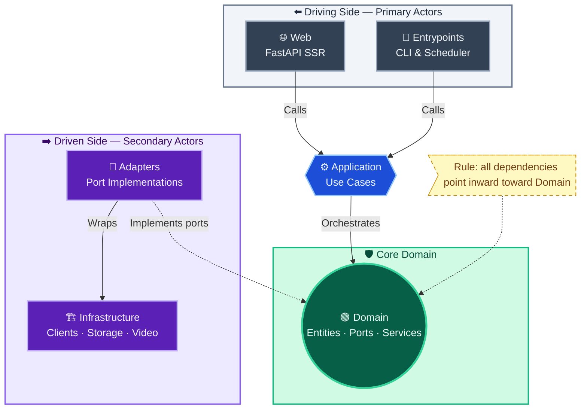
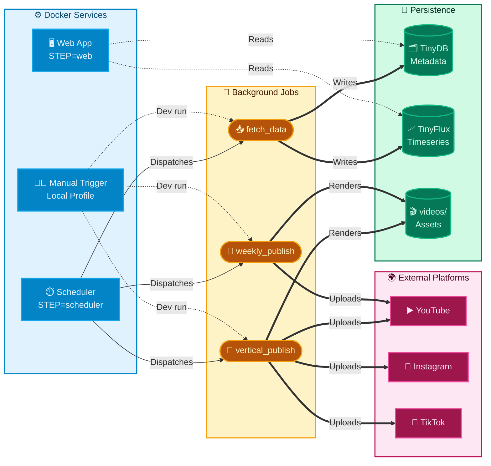

# Top Video Generator — Architecture Decision Record

## Status: TaskRunState persistence implemented; P0 web secret/CSRF hardening and task-trigger preflight complete (2026-11-18)

## Overview

Automated pipeline: fetch YouTube trending music data → score and rank → render videos → publish to YouTube/Instagram/TikTok.

The active architecture is hexagonal (Ports & Adapters). The migration away from legacy god files is largely complete.

## Implementation Snapshot (2026-11-18)

- Hexagonal split is operational across `domain`, `application`, `adapters`, `infrastructure`, and web/entrypoint delivery layers.
- `TaskRunState` persists in TinyFlux and feeds the split admin routes; task status and timeline are read through application use cases.
- `RUNNING` is derived by `GetAdminTaskStatusUseCase`: the latest event must be `QUEUED`, no later terminal event may exist, and the event must fall within a 3-minute window. `RUNNING` is not persisted.
- Operational metrics persist in TinyFlux and are exposed through `GET /admin/metrics/status`; `GET /metrics`, `POST /metrics/increment/*`, and related `/metrics` routes do not exist.
- Production startup rejects missing or weak session secrets. Session cookies use production-safe flags and mutation routes enforce a session-bound CSRF token.
- Task trigger preflight validates method, publisher, and force parameters before persisting `QUEUED`; invalid triggers return accessible HTML error fragments.
- Expired admin sessions return a visible HTMX-compatible authentication fragment instead of an empty `403`.
- Admin setup mutations are guarded by the admin session. YouTube OAuth callbacks validate a one-time state, and TikTok cookies are submitted from a valid non-nested form.
- Logout revokes the captured server-known admin session identifier. Busy execution locks return a skipped result so task tracking cannot report false success.
- Route thinness and the Jinja2/HTMX fragment contract remain priority P1 hardening areas.
- TinyDB and TinyFlux remain retained; no SQLite/SQLAlchemy migration is active and no migration readiness gate is currently established.

## Current Layers

```text
src/
|- domain/           canonical models, ports, domain services
|- application/      use cases and orchestration
|- adapters/         source and publisher adapters
|- infrastructure/   youtube, storage, video, social, publisher registry
|- entrypoints/      api server, fetch/publish jobs, scheduler, workers
|- web/              FastAPI SSR delivery with split route modules
|- config/           Pydantic v2 settings
`- shared/           cross-cutting utilities (logging, locks, etc.)
```

Legacy modules `db_client.py`, `yt_client.py`, and `video_processing.py` are quarantined and must not be reintroduced.

## Layer Dependencies



## Entrypoint Boundaries (Clarification)

Entrypoints are thin orchestration layers only.

- Allowed: load settings, build use cases/adapters, trigger workflows, report outcomes.
- Not allowed: business scoring rules, ranking logic, manual cross-layer data shaping, release-window domain decisions.
- Fetch-data orchestration now lives in `src/application/fetch_data_use_case.py`, and weekly horizontal publish orchestration now lives in `src/application/publish_video_use_case.py`; remaining migration gaps are concentrated in selected entrypoint dependency wiring and web contract hardening.

Target direction:

- Keep entrypoint logic as: parse config -> call use case -> emit operational logs.
- Continue shrinking publish entrypoints toward the same model: thin delivery shell, application-owned orchestration.

## FastAPI Dependency Injection Pattern

The web layer uses `Annotated[...]` + `Depends(...)` factories in `src/web/dependencies.py`.

- Settings resolve through request-scoped app state first (`request.app.state.settings`), then fallback to `get_app_settings()`.
- Route handlers receive typed use cases/ports through dependency aliases.
- Unit tests can override factories with `app.dependency_overrides` without mutating process-global environment.

This pattern keeps web routes thin and improves deterministic test setup.

### FastAPI As-Is / Target Contract

| Concern | As-is | Target |
|---|---|---|
| Session secret | Production startup requires a strong `TOP_MUSIC_APP_SECRET_KEY`; development uses an ephemeral key. Session cookies use `Secure=True`, `HttpOnly=True`, `SameSite=lax`, and a 14-day maximum age in production. | Preserve validated startup configuration and production cookie flags. |
| Session revocation | Successful admin login creates a server-known session identifier; logout revokes it and clears the complete session cookie state. | Preserve revocation across all admin routes and test captured-cookie replay. |
| Mutation/CSRF | Admin login, logout, task, publisher, connection, and TikTok credential mutations require a session-bound CSRF token. | Keep CSRF validation on every future admin mutation and cover login, rejection, and valid submission paths. |
| Task preflight | `TriggerAdminTaskUseCase.preflight()` validates method, publisher, and force parameters before route runner resolution. `QUEUED` is persisted only after successful preflight and runner resolution. | Preserve durable terminal events and reject duplicate/invalid dispatches before persistence. |
| Execution lock | Fetch, vertical, and weekly entrypoints return whether the execution lock was acquired. Admin task tracking records `FAILED` for busy locks instead of `SUCCESS`. | Keep runner return values explicit and preserve lock-skipped semantics across entrypoints and tests. |
| OAuth/setup | YouTube setup uses a one-time session state and the setup/TikTok mutation routes require admin authentication. | Preserve state mismatch/logout behavior and keep setup forms single and non-nested. |
| Task status | `TaskRunState` is persisted in TinyFlux; the admin use case derives a 3-minute `RUNNING` window from the latest queued event and later terminal events. | Preserve durable terminal events and derived transient status; expose it through typed use cases, not route-local state. |
| SSR/HTMX | Admin routes use Jinja2 SSR and HTMX partial templates. | Keep full-page SSR and fragment responses distinct, and preserve fragment IDs/status/labels under HTMX contract tests. |
| Route thinness | Split route modules exist, with dependencies and use cases available through `src/web/dependencies.py`. | Keep route handlers limited to HTTP validation, use-case dispatch, redirects, and rendering; no business or storage orchestration in routes. |
| Metrics routes | Operational metrics persist in TinyFlux and `GET /admin/metrics/status` exposes status. `/metrics` and `/metrics/increment/...` do not exist. | Preserve the admin metrics contract and add tests; do not document or rely on absent `/metrics` routes. |

## Async Publishing Pattern

Publishing fan-out is coordinated with `asyncio.TaskGroup` in application/use-case flows.

- One task per platform publisher.
- Per-task exceptions are captured and converted to `PublishingResult(success=False, error=...)`.
- Partial failures are reported without aborting the whole batch unless a use case explicitly requires fail-fast behavior.

This behavior is implemented in `src/application/publish_video_use_case.py` and `src/application/publish_vertical_use_case.py` and should remain the default for multi-platform publishing.

## Runtime Topology



## ADR-001: TinyDB + TinyFlux

- **Decision:** keep TinyDB + TinyFlux for the current phase.
- **Rationale:** workload and deployment are still mostly single-instance.
- **Scope:** retain both stores until a concrete, measured migration need is established. No SQLite/SQLAlchemy migration is active or currently justified by the reviewed evidence.
- **Migration readiness:** no readiness gate is established, and the ADR-001 revisit triggers are not evidence that migration should begin now.
- **Revisit trigger:** sustained concurrent writers, stronger backup/restore requirements, richer metadata queries, or long-retention analytics needs.

## TinyFlux Analysis for TaskRunState

**Why TinyFlux for task_status_use_case instead of TinyDB:**

TaskRunState is time-series data (task execution history), not metadata. TinyFlux is optimized for append-heavy workloads with time-based queries, while TinyDB rewrites entire JSON files on each write.

**TinyFlux advantages for task execution timeline:**

1. **Append-only storage:** Each task event = 1 insert (O(1)), TinyDB rewrites entire JSON file each time.

2. **Time-based queries:** `get_task_events_since(task_method=FETCH, since=7_days_ago)` uses TinyFlux's native time indexing.

3. **Multiple measurements in single file:** Single `db_timeseries.csv` contains:
   - "Video visualizations" (VideoPoint data)
   - "Task run state" (TaskRunState data)
   - "Operational metrics" (pipeline stage metrics)

4. **Retention support:** OperationalMetricsRepository already uses `retention_days` parameter for automatic cleanup.

**Current architecture:**
- `TaskRunStateRepository.get_latest_task_event()` → fetches most recent event
- `TaskRunStateRepository.get_task_events_since()` → fetches 7-day history for timeline
- `GetAdminTaskStatusUseCase.execute()` → combines both for status + timeline

**Timeline display:**
Admin panel now shows 7-day task execution timeline with:
- Timestamp (HH:MM for recent, MMM DD HH:MM for older)
- Status (queued/success/failed)
- Error messages (when available)

**Future considerations:**
- If concurrent writers appear → consider InfluxDB/TimescaleDB
- If retention needs become complex → split into separate files
- If metadata queries need indexing or SQLite migration readiness is demonstrated → reassess separately; no SQLite migration is active now

## ADR-002: Scoring in Domain Service

- Scoring is canonically implemented in `src/domain/services/scoring_service.py`.
- Current state: main flows already call the domain scorer; remaining work is consistency hardening (shared fixtures, invariants, and regression tests around ranking semantics).

## ADR-003: Commit Messages

- Format: `type(scope): description`
- Avoid generic, context-free messages (e.g. `fix`, `update`).
## ADR-004: Release Kind Transition Policy

- **Decision:** Implement staged transition from `release_kind=null` legacy compatibility to strict `release_kind` requirement.
- **Current phase (Phase 2.0):**
  - Reads: accept null (fallback to DAILY_VERTICAL).
  - Writes: always include explicit `release_kind`.
  - Telemetry: track count of legacy null reads; fail-fast if residual legacy > threshold.
- **Later backfill phase:** Backfill null → inferred kind in `db_release.json` after the legacy-read residual is understood.
- **Later strict-read phase:** Stop accepting null reads; any remaining null → error + operator alert.
- **Rationale:** Eliminates ambiguity in daily vs weekly idempotence checks; allows confident separation of publish workflows by schedule.
## Current Priority Debt

1. **P0 complete — Session and mutation security:** production rejects missing/weak session secrets, session cookies are hardened, and admin mutations validate session-bound CSRF tokens.
2. **P0 complete — Task-trigger preflight:** method, publisher, and force parameters are validated before runner resolution and `QUEUED` persistence.
3. **P1 — Web contract hardening:** keep split FastAPI routes thin and preserve Jinja2 SSR/HTMX fragment IDs, labels, statuses, redirects, and accessible auth/error feedback under route and fragment tests.
4. **P1 — Operational visibility:** continue hardening task history, scheduler heartbeat/error reporting, storage integrity, and the persisted metrics/status contract.
5. **P2 — Publisher and entrypoint wiring:** reduce repeated publish dependency wiring and keep application orchestration outside entrypoints and routes.
6. **P2 — Storage migration readiness:** retain TinyDB/TinyFlux; collect concrete concurrency, backup, query, and retention evidence before considering SQLite/SQLAlchemy migration. No migration is currently active.

## Operational State Semantics

Canonical task states and their sources of truth:

| State | Meaning | Source | Transition Trigger |
|-------|---------|--------|--------------------|
| **QUEUED** | Operator dispatch was accepted; execution is not confirmed | Persisted `TaskRunState.status=QUEUED` | Trigger preflight accepts dispatch and persists the queued event |
| **RUNNING** | Transient inferred state inside a 3-minute window | Derived by `GetAdminTaskStatusUseCase`; not persisted | Latest persisted event is `QUEUED`, no later terminal event exists, and the queued event is within 3 minutes |
| **SUCCESS** | Job completed without error; terminal state | Persisted `TaskRunState.status=SUCCESS` | Job completion is persisted as a terminal event |
| **FAILED** | Job terminated with error; terminal state | Persisted `TaskRunState.status=FAILED` | Job exception is persisted with error detail as a terminal event |

**Key invariant:** `QUEUED` means only that a request was accepted, not that execution started or succeeded. Any later terminal `SUCCESS` or `FAILED` event supersedes an earlier `QUEUED` event. `RUNNING` is derived for recent queued events and disappears outside the 3-minute window.

**Admin panel cards:**
- Daily/Weekly task cards show last TaskRunState, not inferred timestamp.
- Trigger endpoint feedback remains request-acceptance semantics only; final success/failure is sourced from persisted TaskRunState events.

## Immediate Next Steps

1. **P0 complete production configuration:** production startup validates the session secret and cookie policy is production-safe.
2. **P0 complete mutation protection:** admin POST mutations validate session-bound CSRF tokens.
3. **P0 complete task dispatch preflight:** trigger parameters are validated and runner resolution occurs before `QUEUED` persistence.
4. **P1 web contracts:** test Jinja2 SSR and HTMX partial IDs, status labels, redirects, auth/error fragments, and thin route dispatch.
5. **P1 operational observability:** retain durable terminal `TaskRunState` events and harden task history, heartbeat/error reporting, and `/admin/metrics/status`.
6. **P2 storage readiness:** keep TinyDB/TinyFlux; base any later migration decision on concrete concurrency, backup, query, retention, and write-latency evidence.

---

### Rationale: Why Not Prometheus/Broker/Metadata Migration?

**Prometheus metrics backend:** Out of scope because operational metrics are persisted in TinyFlux and exposed through `GET /admin/metrics/status`. The `/metrics` route and `/metrics/increment/...` routes do not exist, so they are not a current metrics contract. A centralized backend would add infrastructure and scraping complexity without evidence of current need.

**Message broker (Redis/RabbitMQ):** Out of scope because all jobs are orchestrated from a single scheduler and entrypoints. Async retry, job queuing, and worker pools make sense only after distributed deployment. Current single-server design has no distributed failure modes that a broker would solve.

**Migrating metadata off TinyDB or time-series data off TinyFlux:** Out of scope while the stores remain operational for the current workload and no migration readiness gate is established. ADR-001 revisit triggers are planning criteria, not proof that SQLite/SQLAlchemy or another migration is due now.

## Explicit Non-Goals

- Prometheus or any centralized metrics backend is out of scope while `GET /admin/metrics/status` remains the persisted metrics contract. `/metrics` is absent.
- A message broker such as Redis or RabbitMQ is out of scope because the workload is not distributed across multiple machines.
- Replacing TinyDB or TinyFlux with SQLite/SQLAlchemy is not active or currently readiness-gated; retaining both file-backed stores is the current decision.

## Improvement Roadmap

### Storage Notes: Single-Server Persistence

TinyDB and TinyFlux remain the retained stores for the current single-server phase. No SQLite/SQLAlchemy metadata or time-series migration is active or currently readiness-gated.

#### Revisit Criteria

Revisit the storage decision only if one or more of these become true:

- Concurrent writes start happening from more than one long-lived process or worker group.
- We need ACID semantics, WAL-backed recovery, or reliable point-in-time backups.
- Metadata queries need indexes, stronger filtering, or more predictable performance than linear file scans.
- The size of the JSON database starts to affect write latency or startup time.
- Auth, release, or video metadata needs clearer operational tooling than a flat file can offer.

Time-series storage should be reviewed separately. TinyFlux can remain the right fit while the workload is append-heavy and operational analytics stay simple.

## Anti-Patterns & CI Guardrails

Enforced via pre-commit + ruff rules:

1. **Legacy module re-introduction:** Imports from `src.db_client`, `src.yt_client`, `src.video_processing` → CI rejection.
2. **Business logic in entrypoints/web:** Scoring, ranking, release validation outside domain/application → PR comment + requirement to move.
3. **Protocol runtime checks:** `isinstance(..., VideoPublisher)` module-level → linting failure.
4. **Pydantic v1 APIs:** `Optional[X]` instead of `X | None` in new code → linting failure.
5. **Mutable default args:** `def func(x={}):` → linting failure.
6. **Raw API dicts crossing boundaries:** Domain/application receive canonical models, not raw JSON/SDK objects → architectural review.
7. **Development-secret fallback in production:** Do not rely on a fallback secret or weak session-cookie policy for deployed admin access; require validated configuration.
8. **Task state fake success:** A trigger route must report accepted/rejected/preflight-failed semantics only. Do not claim `SUCCESS`, `FAILED`, or execution start unless that state is persisted or otherwise established.
9. **Business logic in routes:** Route handlers must not implement scoring, ranking, persistence, task-state derivation, or publish orchestration; delegate to application use cases and typed dependencies.
10. **HTMX fragment contract drift:** Do not change HTMX fragment IDs, status labels, or partial response behavior without matching route/fragment tests.
11. **CSRF omission:** Do not add or change admin mutation endpoints without session-bound CSRF validation and login/invalid/valid submission tests.
12. **Queued event without preflight:** Do not persist `QUEUED` until method, publisher, force, and runner resolution have passed validation.

## Minimum Validation for Architecture-Relevant Changes

| Check | Command |
|---|---|
| Clean import | `python -c "import src"` |
| Lint | `ruff check src/ tests/` |
| Type check | `ty check src/ tests/` |
| Tests | Run tests relevant to touched areas |
| P0 secret startup | Production rejects missing/weak `TOP_MUSIC_APP_SECRET_KEY`; development uses an explicit or ephemeral app secret. |
| P0 mutation CSRF | Admin login, logout, task, publisher, connection, and TikTok credential mutations reject missing/invalid CSRF tokens. |
| P0 trigger preflight | Invalid method, publisher, or force is rejected before task-state persistence. Runner resolution happens before `QUEUED`. |
| P0 auth/HTMX feedback | Expired admin sessions return a visible auth fragment and mutations expose repeat-click protection. |
| P0 session revocation | Captured authenticated cookies replay after logout are rejected by the server-known session revocation set. |
| P0 OAuth state | YouTube setup callbacks accept only the one-time state stored in the admin session. |
| P0 setup form | TikTok setup uses one form with no nested form, valid label/textarea association, and admin/CSRF validation. |
| P0 lock result | Busy execution locks return `False` and task tracking records `FAILED`, never `SUCCESS`. |
